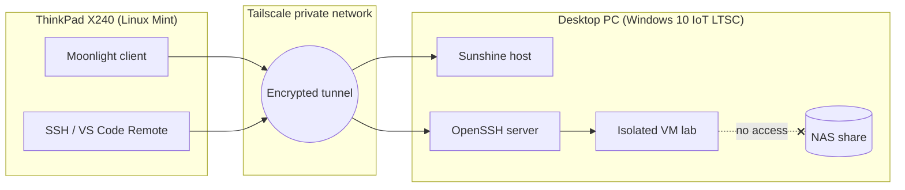

# Remote Compute Homelab

A self-directed project: turning a low-power laptop into a thin client that securely uses a desktop PC's compute from anywhere, with an isolated lab for cybersecurity practice and a small NAS.

> Status: in progress. Each phase is documented in [`docs/`](docs/) after it passes its verification checkpoint.

## Goals

- Use a desktop PC's CPU/GPU remotely from an old ThinkPad (thin client model)
- Keep everything off the public internet (private overlay network only)
- Run an isolated VM lab for security practice (Nmap, Wireshark, Kali, CTF tooling)
- Add a simple NAS without making electricity costs unreasonable
- Document decisions, trade-offs, failures and measurements, not just commands

## Architecture

## Hardware

| Role | Machine | Notes |
|---|---|---|
| Host | Intel i5-11400F, 16 GB RAM, GTX 1650, SATA SSDs + 2 TB HDD | Does the heavy work |
| Client | ThinkPad X240, i5-4300U, 8 GB RAM, 128 GB SSD, Linux Mint | Display + keyboard only |
| Network | Home connection, about 54 Mbps down / 64 Mbps up measured | See [baseline](docs/02-baseline.md) |

## Tool choices (summary)

| Need | Choice | Why |
|---|---|---|
| Remote access network | Tailscale | No port forwarding, works behind CGNAT |
| Terminal / dev work | SSH + VS Code Remote-SSH | Lightweight, key-based auth |
| Graphical apps | Sunshine + Moonlight | Hardware encode on the GPU, low latency |
| Lab isolation | VMs on host-only/NAT networks | Keeps lab traffic away from personal data |

Full reasoning is in [`docs/01-planning.md`](docs/01-planning.md).

## Documentation

| Phase | Doc | Status |
|---|---|---|
| Planning, threat model, cost estimate | [01-planning](docs/01-planning.md) | Draft |
| Network baseline | [02-baseline](docs/02-baseline.md) | Done |
| Tailscale | 03-tailscale | Not started |
| SSH hardening | 04-ssh | Not started |
| Sunshine + Moonlight | 05-sunshine-moonlight | Not started |
| Wake-up and power | 06-wake-and-power | Not started |
| Isolated lab and NAS | 07-lab-and-nas | Not started |
| Decisions and mistakes | [decisions-and-mistakes](docs/decisions-and-mistakes.md) | Ongoing |

New phase docs start from [`docs/00-template.md`](docs/00-template.md).

## Security rules for this repo

No secrets, keys, auth tokens, public IPs, MAC addresses, real hostnames or usernames are committed. Placeholders such as `<PC-TAILSCALE-NAME>` are used instead, and screenshots are cropped or blurred first.

## Results

To be filled in at the end: measured idle power draw and yearly cost, stream bitrate/latency over Tailscale, and a list of lessons learned.

## Author

Student and IT professional building hands-on skills toward a career in security and solutions architecture.
